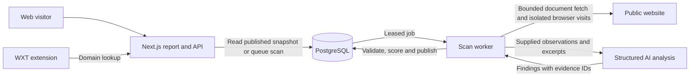

# DataDeal

For the current implementation status, local verification evidence and release decisions, see the [engineering handoff](HANDOFF.md).

DataDeal is a development preview of a consumer privacy report. The web app accepts domains, displays public evidence with provenance, and can enqueue bounded public-document retrieval jobs. Demo reports use fictional evidence.

## Local development

Use Node 24 and Bun 1.4.2. From the workspace root, run `bun --no-env-file install --frozen-lockfile` to install the versions recorded in `bun.lock`. Start the app with `bun --no-env-file run dev` and open http://localhost:3000. A domain without a stored report shows its empty state. The isolated browser test runner can load fixtures.

To enable scans, create a PostgreSQL database and set `DATABASE_URL` in both `.env` and `apps/web/.env.local`. From the repository root, run `node --env-file=.env packages/database/migrate.mjs` to apply and record the migrations. Use `.env.example` as a starting point. On Windows, run `bun --no-env-file run --cwd apps/worker dev` in a separate terminal. Keep the worker behind an outbound network policy that blocks non-public destinations. The web app and worker share PostgreSQL.

Run `bun run typecheck`, `bun run test`, `bun run lint`, and `bun --no-env-file run build` from the repository root. The typecheck runs across the Bun app and package workspaces.

For PDF privacy policies and processing agreements, install Poppler’s `pdftotext` on the worker host (`poppler-utils` on Ubuntu) and verify `pdftotext -v` under the worker’s service account. The worker reads embedded text from public PDFs up to 4 MB, with a four-second conversion limit and a 1 MB text limit. Image-only documents need OCR and remain outside this coverage. An unreadable document supplies no policy evidence.

## Architecture and current coverage

The Next.js app serves reports and admits scan requests. A separate worker performs the public-site visits. PostgreSQL connects the two so readers can keep using the last published report while a refresh runs.



- **Request and capture.** The domain endpoint validates the input and applies admission limits. Concurrent requests for one domain reuse its active job. The worker claims a lease, retrieves documents and captures consent scenarios. A worker that has lost its lease cannot publish over the current owner. [Domain endpoint](apps/web/app/api/v1/domains/%5Bdomain%5D/route.ts) · [Job transactions](packages/database/index.ts) · [Worker orchestration](apps/worker/run.ts)
- **Storage and delivery.** Publication commits the report snapshot, available analysis metadata and eligible capture manifest in one transaction. The website selects the report and checks entitlements on the server. The WXT extension reads the public API projection. [Capture artifacts](packages/database/scan-artifacts.ts) · [Report route](apps/web/app/report/%5Bdomain%5D/page.tsx) · [Public projection](apps/web/lib/published-report.ts) · [Extension popup](apps/extension/entrypoints/popup/main.tsx)

The threat model maps the scanner, account, billing, reward and extension boundaries to their implementation and release checks. [DataDeal threat model](THREAT-MODEL.md)

### Passive evidence and contextual ratings

New publications under methodology 1.0.0 record the rule revision `contextual-practices-5`. The public rating identifies the tested consent scenario. Most scored reports use a confirmed Accept all visit. Each factor describes a practice on a particular page and during a particular consent phase. A cited disclosure about optional advertising can explain a measured event. Merely publishing the disclosure adds or subtracts zero points. Published snapshots retain the rules and values they were issued with.

| Record                 | Contents                                                                                                                                                                                                                                                                                                                   |
| ---------------------- | -------------------------------------------------------------------------------------------------------------------------------------------------------------------------------------------------------------------------------------------------------------------------------------------------------------------------- |
| Browser fact           | Scan-scoped fact ID, page scope, scenario and phase, earliest/latest observed stage when available, source evidence IDs, redacted request and storage classifications, matched response counts and capture limitations.                                                                                                    |
| Offline interpretation | The analyst considers the completed observations and supplied policy excerpts. Each judgment selects a fact, likely purpose, recipient role, proportionality, confidence, an exact supporting policy quotation when applicable, and possible conflict with a consent condition.                                            |
| Published practice     | The worker binds validated judgments to measured operations, recipient, data class, persistence, available linkage and citations. A policy citation or shared data format alone cannot establish that a stored value was transmitted. The report separates the measured fact, its practical significance and its unknowns. |
| Calculation            | Deterministic practice ratings and coverage under each confirmed scenario. Multiple manifestations of one practice cannot accumulate points. A scoped provisional exposure can qualify while other activity remains unknown. Favorable ratings require stronger coverage.                                                  |

The browser samples a signed-out visit and a bounded set of public pages. It records matching HTTP responses separately from attempted requests. End-of-visit storage is a snapshot, not the exact time or script of a write. Worker-side identifier comparison defaults to disabled. Set `DATADEAL_COMPARE_VISIT_IDENTIFIERS=true` on the signed-out Playwright worker to opt in. Each visit records whether comparison was enabled. Comparison is restricted to documented storage/endpoint pairs within one isolated visit. The report keeps the derived relationship. Raw cookie values, credential headers, form contents, full HAR files and identifier hashes are excluded from model input. The extension has no access to this worker-side matching path.

Each storage snapshot inspects up to 64 cookies. Unclassified cookies are counted by registrable site, same-site or outside-site scope, session or persistent lifetime, and remaining expiry bucket when available. Unknown names and values are discarded. These observations carry no score penalty on their own. Older snapshots support only the inspected count of unclassified cookies. The scanner recognizes YouTube’s documented `YSC` and `VISITOR_INFO1_LIVE` names only under `youtube.com`. The cookie label alone does not establish how a particular visit used it. [Google’s cookie documentation](https://policies.google.com/technologies/cookies?hl=en)

The model sees up to ten browser facts per scenario. It sees distinct practices first, then repeated observations. The worker can request a focused second review for scenarios with missing judgments and for answered requests matched to a named policy-list entry that the first review missed. Coverage records how many facts were retained and how many received a validated interpretation.

The Next.js app reads finished scan snapshots from PostgreSQL. The worker claims one job at a time under a time-limited lease. The report keeps source excerpts, classification, retrieval times, and hashes. HTTP-only scans can publish useful policy findings as partial results. A measured default visit can support findings and a separately labeled scenario rating. A signed-out visit with no consent option can qualify for a scoped headline under the criteria below.

Newly published real scans with supported observations also write a versioned capture artifact in the same PostgreSQL transaction as the report. The object key is `scans/<scan-id>/capture-v1.json`. Its manifest identifies rows by zero-based index in the exported report’s evidence array. It records retrieval times, hashes of normalized document text, observed cookie-header counts and browser scenario totals where available. A manifest lists up to 128 supported observations in snapshot order and gives the omitted count. The artifact contains no page URLs, domain lists, excerpts, cookie values, request bodies, browser screenshots or credentials.

Pro report JSON downloads include `captureArtifact` while the object is available. To verify its digest, compute SHA-256 over the UTF-8 bytes of `JSON.stringify(captureArtifact.manifest)`. The local storage adapter keeps these objects in PostgreSQL for 30 days from publication. Expired objects immediately stop appearing in exports, and the worker’s cleanup loop deletes expired rows in batches of up to 500. Published report snapshots have a separate lifetime and remain exportable after expiration. Existing scans have no retroactively generated object. Database backup retention and disk-space reclamation are separate operational settings.

The scanner normalizes domains, rejects non-public DNS results, pins the connection to a validated address, and bounds downloads. The homepage may redirect to the exact HTTPS `www.` alias of the requested hostname. Policy links and later redirects stay on the final homepage origin. Use an outbound firewall in deployment. Scan admission has a global hourly request limit and a 50-job queue cap. Public deployment also needs ingress quotas and a review of resource exhaustion, publication abuse, document retention, and account privacy.

The worker measures browser consent on all eligible public domains by default when a browser proxy is configured. Install Chromium with `bun --no-env-file x --no-install playwright install chromium`. The local Bun launcher starts a loopback HTTPS proxy when browser scans are enabled and no explicit proxy is supplied. It rejects non-public destinations and pins the resolved address. The worker uses separate fresh browser contexts for the default visit and each confirmed consent choice. A scan can complete when it retrieves a readable privacy policy and measures the default visit. Scoring rules can use the resulting evidence.

By default the worker selects up to three additional public content pages from the sitemap and homepage links, prioritizing different sections. Set `CONTENT_PAGE_LIMIT` on the worker to a whole number from 1 to 12. The worker checks the setting at startup. When five eligible pages are discovered and the limit is at least five, all five are selected. Sitemap file, size and time limits still apply, so the report distinguishes a complete selection of discovered pages from complete discovery of an entire site.

Each selected page gets separate default, reject and accept attempts in fresh contexts. Increasing the limit increases browser time and traffic. The advanced report lists paths, per-page visits and discovery coverage. The free report includes material differences and the source supporting each public finding. An article's connections remain distinct from homepage measurements. The AI receives up to nine measured content-page visits spread across the pages and available scenarios. A higher measured default-visit outside-domain count on a sampled page is also available in the extension with a link to the evidence.

The data-flow graph links each attempted connection to the measured page and consent scenario where it appeared. The cross-site provider directory counts each website once even if several pages contacted the same destination. Domains are grouped by registrable domain using public and private suffix rules. An attempted request may have been blocked by the proxy or failed before delivery. The scan retains counts and domain names without storing query strings, request content, or cookie values.

When both consent choices were measured at the same final homepage URL, the public report and extension compare the outside destinations attempted after each click. Each result links to both measurements. A capped list of 20 is reported as a lower bound. The whole-visit counts in the report include activity before the click.

Each scenario opens a fresh, signed-out Chromium context. The worker inspects outbound requests in the browser, including same-site requests. It classifies supported query parameters and text, JSON and form bodies in memory. For example, an email-shaped value under an unknown key and a field named `email` are separate observations. The evidence records the destination's registrable domain, site relationship, consent phase, recognized categories, and counts of attempts and responses. The AI receives these records alongside the policy excerpts. Raw addresses, request bodies, tokens and HAR files are excluded from this handoff. A Plausible-compatible event identifies an analytics request format. Policy evidence is needed to describe who operates that service. An HTTP response establishes neither downstream retention nor sale.

The public comparison score uses the stored result of a confirmed Accept all visit on the report site. If both controls were unavailable across a fully inspected sample, the site’s own visitor policy and the measured visits can support a separately labeled no-choice rating. The API then returns `headlineScenario: "default"` and `noChoiceVisit: true`. An undetected banner alone does not qualify. This applies to current and archived reports across the website, developer API and extension. Separate observations and ratings retain their original scenario and methodology. While a new scan runs, the last published report remains available with its date. The next published snapshot supplies its own coverage and score. Repeating a charged developer report request with its original idempotency key returns the original response and the header `Idempotency-Replayed: true`. A new report read uses the current comparison basis.

The scanner recognizes Permutive’s documented publisher-scoped visitor ID storage convention. Its consent and session markers serve different purposes. The collector recognizes Permutive’s Events API only when a POST uses the vendor’s documented event endpoint and the same JSON event contains a populated event name, UUID-shaped user ID and properties object. A response confirms an exchange, while an exact ephemeral match can link the previously observed ID with that request. The scan keeps categorical facts. A visitor may have a different ID at another publisher. [Permutive SDK identity](https://docs.permutive.com/sdks/web/javascript-sdk/core-concepts/identity-management) · [SDK storage verification](https://docs.permutive.com/sdks/web/javascript-sdk/getting-started/verification) · [Permutive Events API](https://docs.permutive.com/api/events/track)

Chatwoot documents a conversation cookie that supports continuity across pages and visits. The scanner recognizes the functional family and persistence without decoding its contents. Evidence of the operator, purpose and necessity determines whether the observed use supports a limited functional assessment. [Chatwoot cookie guide](https://www.chatwoot.com/hc/user-guide/articles/1677778232-which-cookies-are-used-by-chatwoot)

The browser starts at the final homepage URL recorded by the HTTP scanner. Leave `DATADEAL_CONSENT_DOMAINS` unset or set it to `*` for every eligible public domain. To limit coverage, set a comma-separated list of exact scan hostnames. Use the requested domain even when its homepage redirects to its HTTPS `www.` alias. An explicitly empty value enables HTTP-only scans in the local launcher.

The worker sends public policy excerpts and bounded browser observations to the analyzer. It validates citations and stores model and prompt versions with private results. Validated summary sentences can appear with their policy citations. If analysis is unavailable, the report can still render supported policy highlights or cite eligible excerpts. Validated interpretations can affect which deterministic rule applies. PostgreSQL integration tests cover subscription access, watchlist scheduling, and in-app document-change alerts. Local tests cover browser observation and display-ad consent. Live provider checkout, live advertising, and rewarded unlocks still need verification.

## Scoring decision record

### ADR 001 — Evidence, scoring and access

**Accepted for public methodology 1.0.0.**

1. **Compute scores deterministically.** Readers should be able to trace a rating to the measured practice and reproduce it from the same validated facts and rule revision. Insufficient coverage can leave a scenario unrated. [Contextual rules](packages/scoring/contextual.ts) · [Public headline selection](packages/scoring/index.ts)
2. **Use AI for structured interpretation.** Policy language can explain the purpose and recipient of a measured event. The model proposes a practice or plain-language statement with source IDs. The publisher checks the cited facts and quotations before using it. This keeps factual corrections auditable and gives the scoring rules a stable input. [Analyst schema and validation](packages/ai/index.ts) · [Practice publication](packages/ai/practices.ts)
3. **Assess processors by what they do.** A processor helping an operator answer a support request can have a proportionate, limited use for an identifier. Sending a persistent ID to an independent advertiser has different consequences. A hostname alone establishes neither a processing agreement nor a recipient’s purpose. [Processing-document checks](packages/scanner/processing-documents.ts) · [Paired scoring cases](packages/scoring/contextual.test.ts)
4. **Keep critical warnings and their sources free.** Someone deciding whether to hand over personal data needs the material risks and enough evidence to check them, including when an ad is unavailable. The public projection carries warnings and their evidence links. [Public warnings](apps/web/lib/public-warnings.ts) · [Public response](apps/web/lib/published-report.ts)
5. **Offer two ways to fund deeper analysis.** Pro covers recurring use across domains and removes ads. A voluntary rewarded ad gives an occasional reader access to one domain for a limited time. Both approaches leave the free decision and its sources accessible. The Google sample grant is development-only. Live inventory and trustworthy completion verification are requirements for a production reward. [Report access checks](apps/web/app/report/%5Bdomain%5D/page.tsx) · [Development reward boundary](apps/web/lib/local-reward.ts)
6. **Assess DataDeal’s own advertising.** Funding creates a potential conflict of interest. The headline must describe what a free visitor encounters under the same consent scenario and scoring rules as every other site. An ad-free Pro visit can be separately measured. The local self-assessment exercises both paths with sample inventory and issues no public score for the loopback site. [Free and Pro self-assessment](e2e/self-assessment.e2e.ts)

### Implementation and historical revisions

Prompt 19 can request one additional reading of up to four same-scan policy passages when mixed browser and document analysis produces no publishable policy explanation. Each recovered statement must cite its original passage. For a historical local report with an empty policy analysis, run `node --env-file=../../.env --import tsx ../../tools/local-worker.mts --recover-summary DOMAIN SCAN_ID` from `apps/worker`. Supply `--apply` to save a timestamped, model-attributed addendum. This command reads the stored evidence and analysis. It preserves the original measurements, assessment, rating and scan history.

Public methodology 1.0.0 stores its rule revision with each new result. Under `contextual-practices-5`, each phase is assessed from normalized passive browser facts and validated practice interpretations. A finding must reference the same scan, selected page, scenario and event. A role or purpose needs a verbatim first-party policy citation. An exact ephemeral value match within the isolated browser visit can corroborate the transmission of a previously sampled persistent ID. Request counts, cookie counts, a provider name and a policy mention alone have no numeric value.

Revision `contextual-practices-5` pairs recognized cookie names with their measured storage scope and the same scan’s first-party policy excerpts. The report distinguishes a cookie observed in the browser, its declared purpose, and any measured transmission. The local `tools/correct-quiet-visit.mts DOMAIN SCAN_ID --unrated` command previews a correction to the latest eligible unrated revision-4 capture. Run it from the worker workspace with the same Node invocation documented below. Add `--apply` to retain the correction alongside the original ratings.

The deterministic table lives in `packages/scoring/contextual.ts` and supplies the public methodology page. The lowest substantiated practice sets the scenario score. Before a choice, after a confirmed rejection and after accepting all, an exactly linked persistent ID sent to an independent advertising recipient rates 35, 15 and 50 respectively. Material exposure requires a completed, confirmed scenario and validated facts. Replicated requests, storage and transmission of the same identifier, or repeated samples never accumulate additional deductions. Unsupported conditional policy claims remain visible as disclosures. A blocked attempt, opaque body, unknown initiator or unclear recipient role can leave the practice unscored.

Revision `contextual-practices-3` can use a named provider entry and its governing policy paragraph together. Both are cited alongside the measured event. Service-specific controller responsibility can support an advertising classification without establishing exclusive responsibility, resale or onward delivery. For a known event endpoint the opt-in matcher distinguishes a value sampled before transmission from equality with the final storage sample. A final-sample match does not establish who wrote the value or when.

Revision `contextual-practices-2` gives equivalent directly measured quiet visits the same assessment when the analyst reviews a subset of the selected pages. A functional or quiet visit can receive a low-confidence provisional 85 or 80 only when the inspected pages, storage inventories, retained practices and cited policy purposes and sharing are sufficiently covered. Unclassified outside requests, a truncated analysis or missing coverage prevent a favorable rating. Publication never treats an untested signup, logged-in session or backend transfer as measured. Key findings and evidence remain free for every scenario.

Historical snapshots keep their saved result, methodology and revision. A local maintenance command can correct a single eligible `contextual-practices-1` quiet-visit result. Run `node --env-file=../../.env --import tsx ../../tools/correct-quiet-visit.mts DOMAIN SCAN_ID` from `apps/worker` to preview. Add `--apply` to append the reason, timestamp and corrected default result while retaining the original snapshot. The update is transactional and idempotent. Legacy snapshots without contextual data continue through the compatible arithmetic path. The former baseline was 75 with weighted findings. The historical `browser-evidence-2` revision included bounded request/storage signals. The `browser-evidence-3` revision left a consent-conditional advertising disclosure at zero points before choice. Rule-only changes do not generate comparable score-change alerts across revisions.

## Browser extension

Run `bun --no-env-file run --cwd apps/extension dev` alongside the local Next.js server at `http://localhost:3000`. The WXT development extension uses that local API. Run `bun --no-env-file run --cwd apps/extension build` for the Chromium and Firefox release outputs under `apps/extension/.output`. Load the Chromium directory as an unpacked extension. In Firefox, open `about:debugging` and load the manifest as a temporary add-on. The popup uses `activeTab` to obtain the active domain, sends the registrable domain for lookup, and links to the web app for scan requests. The required release API origin is `https://datadeal.app/*`. Opening the popup shows the published score on the toolbar for that tab. To enable automatic ratings, opt in for one HTTPS hostname. On visits there, the extension looks up the registrable domain without cookies or page details, and can show the rating beside a sign-in, registration or checkout form. The site preference is stored locally. Existing reminder-only permissions require a new opt-in for automatic lookup. See the [browser submission guide](apps/extension/SUBMISSION.md) for permissions and package verification.

## Production deployment

The intended Coolify host is **HEL-1** (Helsinki). DataDeal includes the AdSense ownership meta tag on the website and serves the publisher's authorized seller record at `/ads.txt`. Both are first-party responses. After `https://datadeal.app` serves the release, select **Meta-Tag** in AdSense, confirm ownership and request the site review. For ad-unit performance after approved AdSense inventory starts serving, use **Reports → Ad units** in AdSense. Google Ad Manager slots and local sample ads have their own reporting. [Site verification](https://support.google.com/adsense/answer/12131223) · [Ad unit reports](https://support.google.com/adsense/answer/9974595)

The [dependency and license review](DEPENDENCY-REVIEW.md) records the frozen package versions, the advisory fix, and where third-party notices ship in the web and extension artifacts.

### Audience measurement

For consent-based website analytics, set `DATADEAL_UMAMI_ORIGIN=https://umami.cloud.thedannicraft.de` and select a website ID for the web service:

| Environment    | Umami website                      | Website ID                             |
| -------------- | ---------------------------------- | -------------------------------------- |
| Production     | DataDeal (`datadeal.app`)          | `eeb2ddca-3ee8-4c41-aac9-db53f26b57da` |
| Local and test | DataDeal Development (`localhost`) | `8f552bfd-2bb7-4c53-93a0-ff339c45d74c` |

Next.js development reads these settings from `apps/web/.env.development.local`. For a local Compose rehearsal, set the development website ID in `.env.compose`. Leaving either setting empty disables collection.

### Run the release stack locally

The [Compose stack](compose.yaml) runs the standalone Next.js app, PostgreSQL 17, the migration command, the browser worker and its private HTTPS proxy. By default, only the web app publishes a port, on loopback at `127.0.0.1:3100`. The normal development server can keep using port 3000.

1. Copy [.env.compose.example](.env.compose.example) to `.env.compose`. Generate a separate random secret of at least 32 bytes for each database password, the account session secret and the guest scan limit secret. Set `OPENAI_API_KEY` to the worker's project key and `APP_ORIGIN` to the HTTPS origin visitors will use for account and billing returns.
2. Supply the license owner's `HEROUI_AUTH_TOKEN` to the build environment. The web build mounts it as a BuildKit secret during the frozen Bun install. The worker and database images build independently of HeroUI. [HeroUI licensing](https://heroui.pro/docs/react/getting-started/licensing) · [Docker build secrets](https://docs.docker.com/build/building/secrets/)
3. From the repository root, run the following commands.

```sh
docker compose --env-file .env.compose build
docker compose --env-file .env.compose up -d
docker compose --env-file .env.compose ps -a
docker compose --env-file .env.compose logs --tail 10 worker
```

The migration service should exit successfully, the worker should log `worker_ready`, and `http://127.0.0.1:3100/api/ready` should return `{"ready":true}`. The admin credential is scoped to database initialization and migrations. Web and worker connections use a separate application role with data access. Initial passwords are applied when PostgreSQL first creates the named volume. Rotate existing credentials in PostgreSQL before updating the service environment.

The Chromium process runs as a non-root user with its sandbox enabled. Its proxy checks destination addresses and accepts HTTPS connections on port 443. The worker also needs outbound access for fetching documents and using the project API. The proxy policy applies to browser traffic. The supplied seccomp profile and a private shared-memory mount support Chromium on the tested Linux runtime. [Playwright container guidance](https://playwright.dev/docs/docker)

For signed-in use, terminate HTTPS at a reverse proxy in front of the loopback web port. Set the trusted client IP header only when that proxy overwrites it. Mail, billing and ad settings are passed only to the web service. `docker compose --env-file .env.compose down` stops this stack and retains its database volume.

To verify locally built images, run `node e2e/compose-smoke.mjs`. The check starts a separate stack with disposable credentials, an empty scan queue and a randomly assigned loopback port. It exercises public report and pricing routes, service isolation, migrations and a restart, then removes its own volume and containers. Run `node e2e/docker-context.mjs` after changing build inputs to check that local credentials, dependencies and generated output stay outside the contexts.

Set `APP_ORIGIN=https://datadeal.app` and keep `DATADEAL_DEMO=false`. The web server requires a Node runtime and PostgreSQL for scans. Run the worker as a separate long-lived service. The domain registration and a Workers option do not provision those services.

Initialize the new deployment database with `bun --no-env-file run --cwd packages/database migrate` and `DATABASE_URL` injected by the host. The command records each applied migration and is safe to run again on databases it initialized. Existing databases created by manually applying SQL need their migration history reconciled before switching to the runner. Then run `bun --no-env-file run build` with the deployment environment configured. Start the built web app with `bun --no-env-file run start` and the separate scan process with `bun --no-env-file run --cwd apps/worker start`. Both services accept environment variables injected by the host. The production worker does not load the root `.env`. Inject a separate production project API key as `OPENAI_API_KEY` from the deployment secret store. Route the production HTTPS origin to the web app and use `APP_ORIGIN` to match it exactly. The worker and web app must point to the same PostgreSQL database.

For a standalone web deployment, run `bun --no-env-file run --cwd apps/web build:standalone` on the target operating system and architecture. Deploy `apps/web/.next/standalone` and run `node apps/web/server.js` from inside that directory. The build copies compiled styles and public assets, removes copied env files, and rejects artifacts containing local OAuth tooling or environment directories. Supply secrets and `PORT` through the deployment environment. On Windows hosts without relative symlink support, the server creates dependency junctions inside the deployed directory at startup. For a read-only installation, run `node prepare-package-links.cjs` from that directory if the file is present, then make the installation read-only. The scan worker is a separate service.

Provide `HEROUI_AUTH_TOKEN` as a build secret before `bun --no-env-file install --frozen-lockfile` on a clean CI or Linux host. HeroUI Pro installs its licensed components during postinstall. The workspace skips the optional keyring package's native rebuild, so CI should use the token instead of depending on a desktop keyring.

On the Linux worker host or image, install the Chromium version and system dependencies required by Playwright with `bun --no-env-file x --no-install playwright install --with-deps chromium`. Run Chromium with its sandbox enabled and restrict browser egress to a proxy that blocks non-public destinations after DNS resolution. Inject its address as `DATADEAL_BROWSER_PROXY`. The production worker requires this variable at startup and defaults to browser scans for all eligible public domains.

Use `GET /api/ready` as the web readiness probe. It returns `200` when PostgreSQL can resolve and read required scan, account, billing, and watchlist columns. It returns `503` if the database is unavailable, unconfigured, or missing required schema. The worker checks the same schema and launches sandboxed Chromium with its scan configuration before claiming jobs. Monitor the worker separately for `worker_ready` and verify proxy egress on a staging scan.

Verify each provider in staging before enabling its public feature. Use the real provider to deliver a single-use sign-in email, complete a Creem test checkout and receive its signed webhook, and serve an opted-in Google display ad. Run one worker scan and confirm that the generated policy summary matches its cited evidence. For browser observations, verify the configured proxy and repeat a scan that records its default and available consent choices. Local mail, simulated webhooks, and stubbed publisher responses exercise application behavior only.

Once the web host is ready, configure its custom domain and add the records it specifies in the Cloudflare zone for `datadeal.app`. Confirm the apex resolves from public DNS, then verify the public HTTPS certificate and readiness route with `curl --fail --silent --show-error https://datadeal.app/api/ready`. From that same origin, submit a public domain and confirm the worker publishes the report with evidence. The extension uses the apex origin for live API requests.

Signed-in Pro accounts get priority on up to three manual rescans per UTC hour after migration 0010. The request still counts toward normal scan limits and must be for a site with a published report. The worker leases eligible jobs in this order:

1. Jobs waiting at least ten minutes, oldest first across all tiers.
2. Eligible Pro priority rescans.
3. First reports for sites without a published measurement. A prior failed attempt or demo still qualifies.
4. Routine refreshes of sites with a published report, including partial or unrated reports.

Within each group, the oldest request goes first. Repeated requests for the same queued domain keep its original position. The ten-minute threshold changes ordering at the next available lease. It does not guarantee a completion time.

After migration 0012, Pro accounts can save a registration-advice preference on the account page. The preference adds a data-minimization tip to reports without changing the score or evidence. The saved preference is included in account export and removed with account deletion.

The extension reads the same preference from the signed-in DataDeal session when the browser permits its cookie. The profile request carries no active domain. If there is no usable Pro session, the popup displays the public report without personalization.

Set `NODE_ENV=production` and run `bun --no-env-file run --cwd apps/extension package` to generate Chromium and Firefox submission archives in `apps/extension/.output`, including the Firefox source archive. To rebuild both browser packages, extract the source archive, run `bun --no-env-file install --frozen-lockfile`, then set `NODE_ENV=production` and run `bun --no-env-file run --cwd apps/extension build` from the extracted workspace. The production environment setting is required to reproduce the release bundle.

## Verification

Run `bun --no-env-file x --no-install playwright install chromium` and `bun --no-env-file x --no-install playwright test` to exercise the fixture report in Chromium. Set `DATADEAL_SCREENSHOTS=true` to save viewport captures under `test-results`. For PostgreSQL integration tests, apply all migrations to an empty disposable database, set `DATADEAL_TEST_DATABASE_URL`, and run `bun --no-env-file run test --no-file-parallelism`. The suites share a scan queue and must run serially.

To run the account browser suite in isolation, apply all migrations to a fresh disposable database, set `DATADEAL_TEST_DATABASE_URL`, and set `DATADEAL_AUTH_TEST_MAIL_FILE` to a private temporary outbox path. Configure a development `BETTER_AUTH_SECRET` and leave `DATADEAL_TEST_URL` unset. Run `bun --no-env-file x --no-install playwright test e2e/account.e2e.ts`. Playwright starts its own loopback server and uses one worker for the shared outbox.

### AI extraction setup

To diagnose a missing AI summary on a local published scan, run `bun --no-env-file run --cwd apps/worker dev --replay DOMAIN SCAN_ID`. This uses the saved browser and policy evidence, runs inference once and prints the verified candidates. The original report and scan date are preserved. The queue worker retries an interrupted analysis once when it still owns the job; provider authentication and billing failures end the attempt.

The production worker runs policy analysis with the pinned OpenAI model `gpt-5.4-mini-2026-03-17`. Set `OPENAI_API_KEY` in the worker environment. Inject it from the production secret store. The provider receives bounded first-party policy excerpts and, when measured, summarized browser observations for each consent scenario. Storage and cookie counts are included without names or values. The worker checks that every public summary sentence cites a matching policy section and exact supporting quote, including when reusing cached output. Summaries describe what the policy says and do not change the score. If an OpenAI request fails, the worker still publishes the scan evidence.

The Windows development worker uses ChatGPT plan access via OpenAI OAuth and the Responses API. Run `bun --no-env-file run --cwd apps/worker dev` with a loopback database. Bun starts the worker on Node so local pinned HTTPS requests use the same transport as production. The worker loads database settings from the local root `.env`. It stores the access and refresh tokens in the ignored `.env.development.oauth`, protected with Windows DPAPI, and renews access automatically while the grant is valid. A fresh sign-in is needed if the saved session has no refresh token or OpenAI revokes the grant. Run `bun --no-env-file run --cwd apps/worker dev --smoke` to verify inference or add `--refresh` to verify renewal. Keep the OAuth cache and development launcher outside deployment artifacts. The production entry point imports only the API-key analyzer and shared worker.

Scan requests share a 120-request hourly limit. Signed-in free accounts have a five-request allowance per UTC day. Configure `DATADEAL_TRUSTED_CLIENT_IP_HEADER` behind an ingress that overwrites that header with one canonical client IP and prevents direct access to Next.js. Set `DATADEAL_SCAN_LIMIT_SECRET` to a random secret of at least 32 characters. This enables a ten-request hourly client limit and a five-request daily guest limit. Production guest requests return 503 when the trusted client identity cannot be established. Existing reports stay readable and signed-in free requests still have an account-level daily limit. The worker cleans up expired request buckets. Concurrent requests for the same domain reuse the queued or running scan and spend a single allowance. Domain cooldowns and a full queue do not spend allowance.

The Firefox build declares required browsing activity because opening the popup sends the active registrable domain to DataDeal. It targets Firefox 140 or later for Firefox's built-in desktop permission flow. Before submission, verify the install prompt and popup against a deployed API on each supported browser.

### Passwordless account setup

Apply migration 0004 and set `BETTER_AUTH_SECRET` to a random secret of at least 32 characters. Set `APP_ORIGIN` to the exact origin users visit. Production requires HTTPS, `DATADEAL_MAIL_MODE=resend`, a Resend key in `RESEND_API_KEY`, and a verified sender in `DATADEAL_MAIL_FROM`.

For local development, bind Next.js to loopback, set `DATADEAL_MAIL_MODE=local`, and set `DATADEAL_LOCAL_MAIL_FILE` to an absolute path outside the public directory. The worker does not need access to these settings. The file contains the latest sign-in URL, which expires after 10 minutes. Keep the file private and delete it after use. To run the browser account tests against an existing local server, set `DATADEAL_AUTH_TEST_MAIL_FILE` to that path and `DATADEAL_TEST_URL` to the exact value of `APP_ORIGIN`. Run the account tests with one worker because they share the outbox.

When a user confirms account deletion by email, DataDeal checks each linked subscription at Creem, cancels it immediately and verifies the cancellation before removing the account. If Creem cannot confirm, the account stays accessible and the user can request another confirmation link. Apply migration 0031 for this flow.

### Developer API preview

For a loopback development instance, apply migration 0015 and set `DATADEAL_DEVELOPER_API_PREVIEW=true` in the web process. Create a token at `/account/developer` and send it as an `Authorization: Bearer <token>` request header to `GET /api/v1/developer/reports/:domain`. The endpoint returns the public projection of an existing published report. It accepts 60 requests per minute per token and returns HTTP 429 with `Retry-After` when the limit is reached. This preview is available only on loopback in development and does not spend credits or enqueue scans.

For the prepaid preview and its purchase receipts, apply migrations through 0032. Set `APP_ORIGIN=http://localhost:3000`, `CREEM_MODE=test`, `CREEM_API_KEY`, and `CREEM_WEBHOOK_SECRET` in the local web environment. Use the same sandbox key for Pro and prepaid credits. The credit-pack and checkout scopes are `checkouts:write`, `customers:write` (portal), `transactions:read` (refund lookup), `customer-credits:read`, `customer-credits:write` and `events:write`. The two count meters can be managed and inspected in the Creem dashboard. Configure `CREEM_CREDIT_PACK_PRODUCT` for a one-time EUR product, `CREEM_CREDIT_PACK_CREDITS` for its units, and `CREEM_CREDIT_PACK_PRICE_CENTS` for its price. Configure at least one paid operation. Each new checkout signs the offered price and credit quantity. A later offer change does not change what a buyer receives. Earlier checkouts without these metadata fields still require their original pack configuration to settle. DataDeal records offered sandbox product IDs so a refund for a retired pack can be retried if it arrives before the purchase webhook.

Creem Customer Credits holds the spendable balance. DataDeal credits the customer's account when it verifies the signed `checkout.completed` event and paid order. Use an ordinary one-time product with this webhook-driven grant. A second automatic product grant would credit the purchase twice. The developer account shows the current provider balance and entries. Older local ledger entries remain available in the account export. A full `refund.created` event requests a reversal of the original transaction. Partial refunds, disputes and live pack sales remain open. [Creem Customer Credits](https://docs.creem.io/features/customer-credits/introduction) · [Transactions](https://docs.creem.io/features/customer-credits/transactions)

Set `DATADEAL_API_REPORT_READ_CREDITS` and/or `DATADEAL_API_SCAN_CREDITS` to positive integers. Send a scoped token and an `Idempotency-Key` with `POST /api/v1/developer/reports/:domain` or `POST /api/v1/developer/scans/:domain`. DataDeal records the operation so that retries can recover the result and reuse the Creem transaction. Insufficient credit returns HTTP 402. The scan endpoint returns HTTP 202 and a status URL for accepted work. Poll it with the same account's scan token. A terminal scan failure queues a reversal. Run `bun --no-env-file tools/local-credit-reconciler.mts` alongside the local services to recover interrupted charges, submit pending usage events and finish reversals.

The usage events `datadeal_report_read` and `datadeal_scan_requested` feed separate count meters in the sandbox. The reconciler stores the ingestion acknowledgement and any Creem warning codes on each operation. Inspect `meter_warning_codes` in `creem_api_operations` for configuration issues. A matching receipt finishes delivery even when Creem warns that the event will not count. Check the meter total separately to verify aggregation. A prepaid operation is already billed by its explicit credit debit. Attaching automatic subscription settlement to the same usage would charge twice. Pro subscriptions and domain-specific ad unlocks have separate entitlements. [Creem usage-based billing](https://docs.creem.io/features/usage-based-billing)

Signed-in users can download their profile and current session metadata from Account. Exports omit session credentials. Account deletion requires a ten-minute email link and a separate confirmation while signed in. Deletion removes the account and its sessions, while public scan reports remain independent of accounts.

The worker prunes expired sessions and verification records, auth rate limits inactive for more than 24 hours, and scan rate-limit buckets older than the previous hour. Cleanup runs at startup and once per minute, at most 500 rows per table each pass. Public scan reports and evidence are unaffected.

### HeroUI Pro theme

The web app uses the saved DataDeal Mouve theme with locally hosted Inter. See `DESIGN.md` and `PRODUCT.md` for the saved design-system export. Fresh development installs require an authenticated HeroUI Pro CLI session. For CI, set the licensed `HEROUI_AUTH_TOKEN` before installing dependencies. The token is only used at install time.

### Display advertising

For newly issued guest report unlocks, requesting a magic link from the browser holding the unlock lets the visitor save that scan to their account. Opening the link on another device also works. The account keeps the specific scan, while the original browser keeps its remaining 24-hour window for the domain. Migration 0034 preserves the original window for older grants, whose records cannot identify whether an account already received them. Run `./e2e/run-self-assessment.ps1 -GuestRewardHandoff` to exercise this flow with disposable local accounts and two published scan versions.

To render Google’s official display test creative locally without an Ad Manager account, open a published report with `?ad-test=1` or set `DATADEAL_LOCAL_SAMPLE_ADS=true` in `apps/web/.env.local` to enable it on all eligible local reports. Explicitly accept advertising consent. The report labels the creative as a Google sample ad. This mode is available only in development and is suppressed for Pro sessions. [Google’s test ad setup](https://developers.google.com/publisher-tag/guides/get-started)

For Google’s official rewarded sample, open a local published report with advanced data and enable the sample inventory. Allow advertising and choose **Watch an ad to unlock**. Completing and closing the sample opens that domain’s advanced report in the same guest browser for 24 hours, including newly published scans during the window. No account is required. The development sample uses the local `BETTER_AUTH_SECRET` and a loopback database. [Google’s rewarded sample](https://developers.google.com/publisher-tag/samples/display-rewarded-ad)

The display banner can load `gpt.js` as soon as the visitor consents. Choosing the video then reuses that script. To trace a click, keep the browser Network panel open and check for an ad request after the click, including requests to `pagead2.googlesyndication.com`. The report uses events for the video slot itself. It distinguishes a script that never initialized, a request Google did not confirm sending, a request awaiting a response, a response that never became playable, and an explicitly empty slot. These events do not identify a visitor-specific viewing limit or when an ad will next be available.

With the local sample inventory enabled, guests can take the direct unlock or opt to choose their reward after the ad. A signed-in reader can choose 50 guaranteed points or a flight paying 0–1,000 points. The wallet supports 50-point report unlocks and eligible refreshes. The server settles each reward once. Volunteer browser studies remain a proposal. Existing paid API credits and their failed-scan reversals use a separate ledger. [Paper Plane rewards](PAPER-PLANE-ECONOMY.md) · [Volunteer browser measurements](VOLUNTEER-MEASUREMENTS.md)

DataDeal uses c15t locally by default. Consent preferences are stored in the visitor’s browser. An optional `NEXT_PUBLIC_C15T_BACKEND_URL` connects an operator-managed consent backend for centralized records. Set `DATADEAL_GOOGLE_AD_UNIT` to the display inventory path, such as `/123456/report`, and check the publisher’s consent requirements before enabling live inventory. The report loads the Google tag only after effective advertising consent. Global Privacy Control restricts the standard Google tag. Where a dedicated limited unit is configured, a specific c15t choice enables the limited GPT loader. A script failure displays a dismissible funding dialog once per tab session. An empty or declined placement takes up no report space. Pro readers see an ad-free report.

The local category consent flow does not issue an IAB TC string. For personalized Google inventory in the EEA, UK and Switzerland, configure a Google-certified TCF CMP before enabling the placement. Google documents possible non-personalized or limited inventory with other CMPs, depending on eligibility. Google can itself receive GPC and activate restricted processing in applicable US states. Set `DATADEAL_GOOGLE_LIMITED_AD_UNIT` to inventory suitable for limited ads. The client uses Google's limited loader with limited ads and restricted data processing set before requesting the slot. Review the account's programmatic limited ads setting, including any anti-fraud storage, and the eligible creative before opting in the unit. [Google limited ads implementation](https://developers.google.com/publisher-tag/samples/display-limited-ad) · [Inventory and invalid traffic storage](https://support.google.com/admanager/answer/9882911?hl=en). [Google CMP requirements](https://support.google.com/admanager/answer/13554116?hl=en) · [Restricted data processing](https://support.google.com/admanager/answer/14117973?hl=en)

Production rewarded unlocks are disabled. In Google Ad Manager, configure the rewarded web ad unit under **Inventory → Ad units → Reward**. Google supports a completion callback to the publisher's verification URL. Before enabling grants, verify how the network authenticates the callback and links it to one reserved offer, guest or account, and domain. Test concurrent offers and replay the same completion to confirm it grants access exactly once. The public web guide does not specify the verification and correlation fields. The browser grant event is used only for the local Google sample. [Rewarded web setup](https://support.google.com/admanager/answer/9116812?hl=en) · [Ad unit settings](https://support.google.com/admanager/answer/10477477?hl=en)

To verify the gate locally, set `DATADEAL_TEST_DATABASE_URL` to a development database with a published report from a real scan. Set `DATADEAL_AD_TEST_DOMAIN` to its domain and leave `DATADEAL_TEST_URL` unset. Run `bun --no-env-file x playwright test e2e/consent.e2e.ts -g "publisher"`. The isolated test server uses a placeholder inventory path.

### Creem billing

Apply the checked-in migrations, including 0033 for Pro purchase receipts. Set `CREEM_MODE=test` in staging with its own database and test products, or `live` with live credentials. Configure `CREEM_API_KEY`, `CREEM_WEBHOOK_SECRET`, `CREEM_MONTHLY_PRODUCT`, and `CREEM_YEARLY_PRODUCT`. In the Creem test dashboard, register the complete HTTPS URL ending in `/api/v1/billing/creem`. A loopback address is only reachable from your machine. For a test without deploying the app, use an authorized HTTPS callback that forwards just this route to an isolated local instance. Use the endpoint-specific signing secret for `CREEM_WEBHOOK_SECRET`. Subscribe to `checkout.completed`, `subscription.paid`, `subscription.canceled`, `subscription.expired`, `subscription.paused`, and `subscription.past_due`. Add `refund.created` when testing prepaid API credits. [Creem webhook setup](https://docs.creem.io/skills/creem-api/WEBHOOKS) Checkout binds purchases to the signed-in user, and access is granted only after a verified paid event. Report pages resolve ad-free Pro access from PostgreSQL. Verify test-mode checkout and webhook delivery before switching to live credentials.

For local checkout, set the server-side variables in `apps/web/.env.local` and use a Test-mode key. The app calls Creem to create checkout sessions and customer portal links. Account deletion also needs permission to read and cancel subscriptions. The optional sandbox credit-pack refund handler also reads individual transactions. Select permissions for those operations and keep the key in local environment configuration. [Creem API reference](https://docs.creem.io/skills/creem-api/REFERENCE)

To restart the local sandbox callback, start the web app on port 3000 and run `bun --no-env-file run dev:creem-webhook` with `cloudflared` on your PATH. The command checks the signing secret against the running app and opens a Quick Tunnel to the webhook relay. In Creem Test mode, edit **DataDeal localhost sandbox** and set its endpoint to the printed HTTPS origin followed by `/api/v1/billing/creem`. Select **Send test event** and check for HTTP 200. Leave the command running during checkout tests. A new Quick Tunnel gets a new address each time.

If the local Cloudflare Quick Tunnel restarts, update the URL on the existing Creem Test-mode webhook and send a signed test event from the dashboard. Keep using the signing secret for that endpoint. Confirm that the public URL forwards only `POST /api/v1/billing/creem` and that an invalid signature receives HTTP 401 before testing another checkout.

To measure DataDeal�s own report, run `pwsh -NoProfile -File e2e/run-self-assessment.ps1 -ReportDomain bild.de` from the workspace root. Use a published report with advanced details in your local database. The driver copies that report to disposable PostgreSQL, starts an isolated web app, and measures six Chromium visits using the normal consent detector. It saves a JSON file with the visit scope, redacted observations and policy excerpts. The Google sample inventory and synthetic Pro account exercise the release candidate locally. Public ratings require evidence from the deployed HTTPS site.

For the isolated billing browser check, use the account browser setup above. Set `CREEM_MODE=test`, a placeholder `CREEM_API_KEY`, a temporary `CREEM_WEBHOOK_SECRET` also passed as `DATADEAL_BILLING_TEST_SECRET`, and product IDs `datadeal-test-monthly` and `datadeal-test-yearly`. Run `bun --no-env-file x playwright test e2e/account.e2e.ts -g "signed billing webhooks"`. The test sends signed synthetic events to the local app without calling the provider.

Subscribers can open the Creem customer portal from `/account/billing`. The server looks up the Creem customer ID from the current session and returns a non-cacheable portal URL. The link is generated only when requested.

Signed-in users can download their account data from `/account`. The JSON includes the account�s recorded Pro subscriptions and checkout references, including purchases awaiting confirmation, plus the domains and scan IDs of reports unlocked for the account.

Pro checkout returns to `/account/billing/return/<request-id>`. The magic link carries that receipt across browsers. A verified `checkout.completed` links the purchase to its subscription, and `subscription.paid` establishes paid access. Either event can arrive first. Older links with a subscription, checkout or order reference check the receipt for the signed-in account. A bare billing link shows membership status. Payment buttons appear when a free user chooses Pro plans.

Credit packs use a separate receipt at `/account/developer/return/{requestId}`. Migration 0032 ties the request to its order and buyer during signed webhook settlement. The receipt shows the number of credits granted or reversed for that order. The wallet shows the current spendable balance. Older receipts containing a Creem order ID remain valid.

A paused subscription or an outstanding renewal opens the existing subscription in billing. The checkout endpoint returns HTTP 409 if the account already has Pro or has a subscription to manage. The paid-through date still controls access. A signed `subscription.expired` event that reports an active subscription can indicate a payment retry. A later signed payment restores access. The portal uses the store connection even when new checkout products are disabled. [Creem subscription events](https://docs.creem.io/skills/creem-api/WEBHOOKS)

Pro subscribers can save up to 100 public domains in `/account/watchlist`. Existing entries remain available for export and removal after Pro access ends. Deleting the account removes its watchlist.

Watchlist alerts appear in `/account/alerts` when a retrieved document’s text hash differs from the previous published scan or when the two scans have different verified accept-all scores under the same methodology, identified rules revision and baseline. The reader rechecks historical score alerts against the snapshots. Document changes remain visible when a score comparison is unavailable. Notifications are in-app and can be muted per site.

Pro history compares adjacent published scans. When the contextual headline score changes, both score-setting practices link to their original evidence. The destination comparison requires fresh, confirmed accept-all visits to the same recorded page with matching observation windows and uncapped post-choice destination lists. The policy reader can highlight an added paragraph about sharing, purposes or transfers when both saved versions preserve the comparable section. These comparisons describe the recorded visits and policy wording. A single capture cannot establish that a provider was permanently added or removed.

The worker checks for due watches every 15 minutes and queues up to three domains per pass. Monitoring requires an active Pro subscription and enabled alerts. A watch can be scanned immediately if it has no scan history. Later automatic scans are eligible seven days after the last request. Manual requests and monitoring share the same deduplication and queue capacity.
